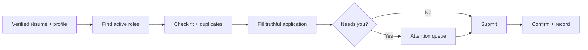

<div align="center">

# JobAppAgent: open-source AI job application agent

### Search roles, match them to one verified résumé, apply within your rules on Greenhouse, Ashby and Lever, and track confirmed submissions.

[](https://github.com/vaibhavarora14/job-application-agent/actions/workflows/validate.yml)
[](https://www.npmjs.com/package/job-application-agent)
[](LICENSE)
[](job-application-agent/SKILL.md)

[Get started](#-get-started) · [Privacy in 30 seconds](#-privacy-in-30-seconds) · [Safety](#-safety) · [Privacy](#-privacy) · [Where to find it](#-where-to-find-it) · [Dashboard](https://job-application-agent-telemetry.varora1406.workers.dev/) · [Security](SECURITY.md)

</div>

```bash
npx job-application-agent@latest install
```

```bash
npx skills add vaibhavarora14/job-application-agent
```

---

JobAppAgent (Job Application Agent) is an [Agent Skill](https://agentskills.io/specification) that helps a coding agent discover, evaluate, complete, and track your own job applications. It uses one verified résumé, checks eligibility and duplicates, and records only confirmed submissions.

<!-- demo-video: embed goes here after approval -->

## 🔒 Privacy in 30 seconds

- OS credential store for profile
- One verified résumé; refuse unverifiable claims
- Never reads cookies/session files; pauses for SSO/MFA/CAPTCHA/legal
- Only records confirmed submissions (filled ≠ applied)
- Analytics/community sharing opt-out via CLI

## 🚀 Get started

Install it with either:

```bash
npx job-application-agent@latest install
```

```bash
npx skills add vaibhavarora14/job-application-agent
```

Then tell your coding agent:

```text
Use job-application-agent to onboard my résumé and job preferences.
```

After onboarding, use natural commands:

```text
search jobs
list discovery sources for India and global remote engineering
apply https://company.example/jobs/123
apply all relevant jobs from this thread: <URL>
run a round of 10
show attention queue
record outcome Company — Senior Engineer — interview
```

Requires Node.js 20 or newer and a browser-capable coding agent.

### Use your preferred agent

Setup templates are available for **Hermes Agent**, **Grok Bot**, and **OpenClaw**:

```bash
npx job-application-agent@latest platforms
npx job-application-agent@latest platforms hermes
```

Replace `hermes` with `grok` or `openclaw` for that guide. These commands print
instructions only; they do not install a Bot, change agent settings, or access
candidate state. Browse the [platform guides](https://jobappagent.com/platforms).
Each template starts in review mode and requires browser validation on its host.
The [Grok Bot template](https://x.ai/bot/0PNQABev0aiAUlhWI83XH) starts in review
mode, where every submit is confirmed.
The existing installer also supports Codex, Claude Code, Cursor, Copilot, and
Gemini skill directories when present.

On Linux, profile storage uses the Secret Service via the `secret-tool` CLI. Install it with `sudo apt-get install libsecret-tools` (Debian/Ubuntu) or the equivalent package manager command for your distribution.

Unlike macOS Keychain or Windows Credential Manager, the Linux Secret Service has no always-running system daemon: a keyring daemon (GNOME Keyring, KWallet, or similar) must be running in the user session for `secret-tool` to store or read the profile. On a desktop login this is normally already the case; on headless servers, containers, or SSH-only sessions, start one explicitly (e.g. `gnome-keyring-daemon --unlock --components=secrets`) before first use.

For one person's agents across several trusted hosts, an optional private Cloudflare D1 backend with R2 (or a private Workers KV blob fallback) shares profile, résumé, application, outcome, round, answer, and attention state. Each host receives a separate revocable credential, and one renewable lease ensures only one host submits applications at a time. See [`CLOUD_STATE.md`](job-application-agent/references/CLOUD_STATE.md).

## ✨ What it does

| Stage | Behavior |
|---|---|
| **Discover** | Searches a shared, versioned catalog of direct careers, ATS platforms, networks, feeds, and job boards, then verifies every lead at the employer. |
| **Qualify** | Checks seniority, skills, location, authorization, compensation, and posting status. |
| **Apply** | Fills forms and uploads one canonical résumé using verified facts only. |
| **Track** | Deduplicates applications and records only visible submission confirmations. |
| **Improve** | Reviews outcomes and proposes targeting changes without rewriting candidate facts. |

## 🤖 Choose your autonomy level

An optional [outreach companion](job-application-agent/references/OUTREACH.md)
qualifies contacts, stores drafts, prepares manual handoffs, and tracks replies
privately. Run `job-application-agent outreach policy status` to inspect it.
It is disabled by default, performs no automated LinkedIn/X access or sending,
and keeps outreach counts separate from applications. Cloud use requires the
`outreach-tracking-v1` private-state migration; local use works with the managed
npm installation on Node 20 or later.

You approve every send. The agent fills applications but never submits them. It stages them as a review batch, and you approve that batch on a local review page, which shows the company, role, URL, fit score, every drafted answer and the résumé. On hosts without a local browser, you approve by typing a short approval phrase in chat. You can untick anything you don't want sent. Approval covers exactly what you saw, once, for 24 hours.

- **`review-each`** (default): one application per review.
- **`routine-auto`**: the agent batches up to 25 routine applications into one review. Sensitive and judgment-heavy steps still stop for you.

**What this does and doesn't enforce.** The CLI refuses to prepare a transmission intent (`cloud intent-prepare`), record a submission (`ledger add`), record a resend (`ledger retry`) or hand over an outreach email (`outreach handoff`) without an approval token for that exact item. It cannot stop a click made directly in the browser. The skill forbids that, and a send made that way is never recorded, counted or shared. Details: [`REVIEW.md`](job-application-agent/references/REVIEW.md).

For durable autonomy across resumable or scheduled runs (discovery, assessment, filling and staging batches; never sending):

```bash
echo '{"mode":"routine-auto"}' | node ~/.agents/skills/job-application-agent/scripts/job-application.mjs autonomy grant --stdin
```

Check or revoke it at any time:

```bash
node ~/.agents/skills/job-application-agent/scripts/job-application.mjs autonomy status
node ~/.agents/skills/job-application-agent/scripts/job-application.mjs autonomy revoke
```

## 🛡️ Safety

The agent pauses for:

- passwords, SSO, MFA, and CAPTCHA;
- legal attestations and government identifiers;
- demographic or voluntary self-identification questions;
- unclear work authorization, sponsorship, location, or compensation;
- claims that cannot be verified from your profile or résumé;
- browser or operating-system permission prompts.

It never reads browser cookies or session files, bypasses access controls, or counts a filled form as a submission.

## 🧭 How it works



The bundled CLI handles private profile storage, résumé import, scoring, duplicate checks, resumable rounds, attention queues, and application/outcome ledgers. The coding agent handles discovery and browser interaction under the rules in [`SKILL.md`](job-application-agent/SKILL.md).

### Optional LLM assist (Free.ai)

For text assists—JD parse, fit-score rationale, short why-company drafts—you can point an OpenAI-compatible client at Free.ai when your agent host supports a custom base URL and API key:

- Base URL: `https://api.free.ai/v1`
- Key: `FREE_AI_API_KEY` from [free.ai/account](https://free.ai/account/?tab=api)
- Own-hardware model example: `qwen7b`

This is optional and assistive only. The skill CLI does not call Free.ai; deterministic `score`, ledger, lease, and intent commands remain the source of truth. Free.ai is not the hosted cloud apply loop, headed browser fill/submit path, or Antigravity/Codex default. Prefer own-hardware models for the OSS/grant path—not premium third-party models. Details: [`FREE_AI.md`](job-application-agent/references/FREE_AI.md).

Discovery combines the reviewed [`SOURCES.json`](job-application-agent/references/SOURCES.json) catalog with an anonymous community registry. Every confirmed application automatically contributes its canonical public job URL, company, role, application channel, and provider; prior confirmed ledger entries backfill during later commands after a one-command disclosure grace period. Jobs, repeatable boards, and feeds are logged pending and become visible in the public dashboard or CLI only after maintainer review. Disable both forms of community sharing independently from analytics with `sources sharing disable`.

New rounds derive reviewed and qualified totals from private per-lead records, including rejection reasons and revision history. Delivery reconciliation subtracts verified failed emails from effective application totals without erasing history; email access is optional, and sent email without acknowledgement remains labelled receipt unknown. See [accounting](job-application-agent/references/ACCOUNTING.md).

Rounds require recorded attempts across at least three distinct discovery sources, including a successful search, and source attribution for confirmed submissions. If more than 60% of submissions come from one source, the agent must explain the concentration. Blockers and empty results are reported; fit requirements never change to meet a source quota. See [round coverage](job-application-agent/references/RUNS.md#discovery-coverage).

<details>
<summary><strong>Installation and update details</strong></summary>

The installer places the skill at `~/.agents/skills/job-application-agent`. Compatible vendor skill directories are also supported when they already exist.

New installs are notify-only: at the start of a workflow the agent runs `updates check`, which only reads the latest version from npm, and tells you when a newer version exists. Nothing is installed until you ask. Automatic background updates (at login and hourly) are an explicit opt-in with `updates enable`. Installs that already had automatic updates on keep them and show a one-time notice explaining how to keep or turn them off.

```bash
npx job-application-agent@latest status
npx job-application-agent@latest update            # install the latest version now
npx job-application-agent@latest updates enable    # opt in to automatic background updates
npx job-application-agent@latest updates disable   # back to notify-only
node ~/.agents/skills/job-application-agent/scripts/job-application.mjs updates check   # read-only version check
```

Set `JOB_APPLICATION_AGENT_NO_UPDATE_CHECK=1` to skip the version check entirely.

Updates are staged and validated before replacement. Private candidate state lives outside the replaceable skill directory.

</details>

## 📍 Where to find it

- [jobappagent.com](https://jobappagent.com) — product site and founding reservation for cloud access (coming soon)
- [GitHub](https://github.com/vaibhavarora14/job-application-agent)
- [npm](https://www.npmjs.com/package/job-application-agent)
- [skills.sh](https://skills.sh/vaibhavarora14/job-application-agent)
- [skills.re](https://skills.re/skills/vaibhavarora14/job-application-agent/job-application-agent)
- [OpenAgentSkill](https://www.openagentskill.com/skills/vaibhavarora14-job-application-agent-job-application-agent)
- [awesome-claude-skills catalog (Chat2AnyLLM)](https://chat2anyllm.github.io/awesome-claude-skills/)
- [Agent Skills discussion](https://github.com/agentskills/agentskills/discussions/537)
- [awesome-agent-skills (Community Skills)](https://github.com/VoltAgent/awesome-agent-skills)
- [SkillHub](https://www.skillhub.club/app/skills/b99cbef5-2445-47d0-94d0-e6d1fac81263) (may still be in review)
- [ClawHub](https://clawhub.ai/vaibhavarora14/skills/job-application-agent)

> **☁️ Cloud access, coming soon.** A hosted agent that runs this same loop for you, so the search keeps going without your laptop. It isn't live yet. A [founding reservation ($49)](https://jobappagent.com) locks the founding price, and we email you when access opens. This open-source skill stays free under the MIT License.

## 🔐 Privacy

| Data | Where it stays |
|---|---|
| Profile | OS credential store, or private D1 with an owner-only local cache |
| Saved profile name and email (contact store, unless opted out) | Private maintainer contact database tied to the anonymous install ID, separate from analytics events (never in PostHog events since 3.7.3); local sharing preference in owner-only state |
| Résumé and ledgers | Owner-only local state, or private D1 plus private blob storage when configured |
| Browser login | Existing browser session |
| Community-sharing preference and delivery receipts | Owner-only local state directory |
| Skill code | Version-controlled installation directory |

Candidate data, résumés, application history, credentials, and browser sessions are never committed to this repository.

Private cloud state is opt-in and isolated from public analytics/community services. Client tokens remain in owner-only host configuration, only token hashes are stored server-side, and browser/Gmail credentials never enter the backend.

Structured usage analytics are enabled by default for product improvement and are keyed to an anonymous install ID. Analytics events do not include your name, email, phone, résumé content, prompts, answers, browser data, or IP addresses. Error events carry only a short sanitized message with file paths, your home folder, OS username, and contact details redacted. `telemetry disable` stops all analytics; previously collected events remain subject to the 24-month retention policy.

Separately from analytics, contact sharing is enabled by default: the name and email you explicitly saved in your candidate profile are stored privately in a maintainer contact database tied to your anonymous install ID, used only to support you and send product updates, and never written into PostHog events (since 3.7.3; the relay also strips such fields from older clients). It is not exposed on public community or job endpoints. `telemetry contact disable` stops future contact sharing (`telemetry identity disable` is an alias), and `telemetry disable` stops both analytics and contact sharing. Opting out does not automatically delete a stored contact; see the [privacy policy](https://jobappagent.com/privacy) for deletion requests.

Anonymous community sharing is also enabled by default, separately from analytics. Confirmed applications share only a canonical public job URL, company, role, application channel, optional coarse discovery source, and derived provider URL—never candidate identity, answers, résumé, score, referral parameters, or submission timestamp. Repeatable discovery surfaces share their bounded catalog metadata through a maintainer-review queue. The registry stores no raw installation IDs; record-scoped contributor hashes are used only for deduplication and counts, never as identity or publication authority.

```bash
node ~/.agents/skills/job-application-agent/scripts/job-application.mjs telemetry status
node ~/.agents/skills/job-application-agent/scripts/job-application.mjs telemetry contact disable
node ~/.agents/skills/job-application-agent/scripts/job-application.mjs telemetry disable
node ~/.agents/skills/job-application-agent/scripts/job-application.mjs sources sharing status
node ~/.agents/skills/job-application-agent/scripts/job-application.mjs sources sharing disable
node ~/.agents/skills/job-application-agent/scripts/job-application.mjs sources jobs
```

See [`ANALYTICS.md`](job-application-agent/references/ANALYTICS.md) for the event contract and retention policy, or view the [public aggregate dashboard](https://job-application-agent-telemetry.varora1406.workers.dev/).

## 🧰 Develop

```bash
npm test
```

GitHub Actions validates the skill and runs the same test suite on every pull request. See [`CONTRIBUTING.md`](CONTRIBUTING.md) for the full local verification and review contract. To try the workflow without installing, paste [`SHARE_PROMPT.md`](SHARE_PROMPT.md) into a new agent chat.

## ⚖️ Responsible use

Use this project only for your own job search. It does not guarantee interviews, offers, eligibility, or application accuracy. Never use it to impersonate another person, bypass CAPTCHA, evade access controls, or make deceptive claims.

Report privacy or security issues through the process in [`SECURITY.md`](SECURITY.md). Do not open a public issue containing personal data or application records.

Released under the [MIT License](LICENSE).
